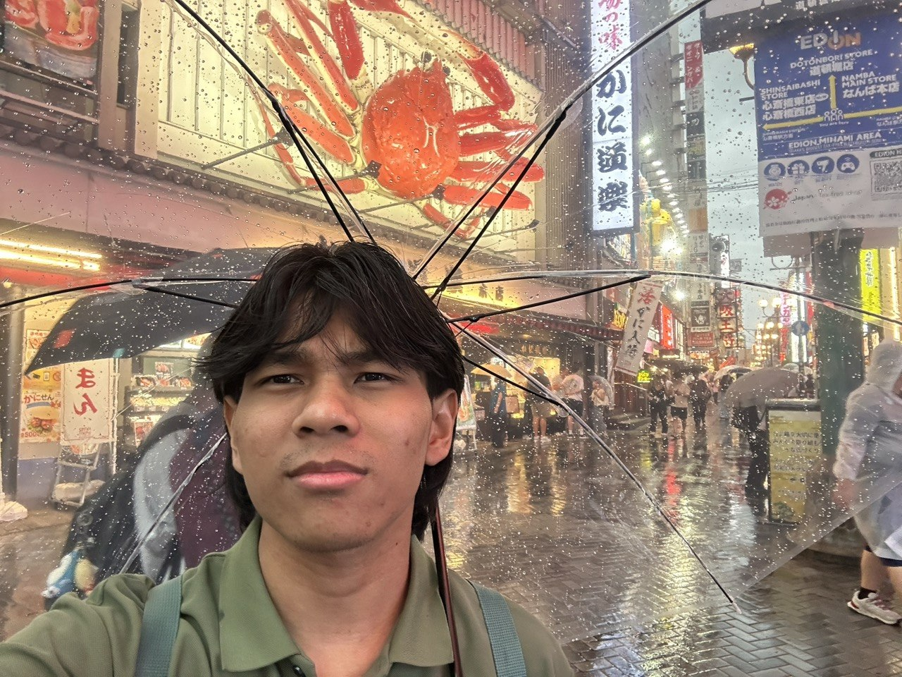

<div align="center">



# Hi, I'm Hafiz Amzar

[](https://github.com/hfizmzr)

> Software engineering student · professional bug creator · full-time ZUS Coffee & Coke Zero enthusiast ☕

</div>

---

## About Me

```ts
const hafiz = {
    role: "Software Engineering Student",
    currentlyDebugging: "my own code (again)",
    strategy: "Copy, Paste, and Pray 🙏",
    aiCodeUnderstanding: 0.0, // "It works and tests pass, we don't ask questions"
    playbackSpeed: 4.0, // anime & movies go brrr
    currentMood: "Watching romance K-dramas at 4x speed just to see if they finally hold hands",
    lifeCrisis: "Thinking about dropping everything to become a professional anime protagonist or maybe a vtuber...",
    fuel: ["Smoking Seven Stars", "ZUS Coffee", "Coca-Cola Zero Sugar"],
};
```
---

## Tech Stack & Tools

<div align="center">

**Languages & Core**


**DevOps & Infrastructure**


**Automation & Workflow**


</div>

---

## 📊 GitHub Stats

<div align="center">


</div>

---
